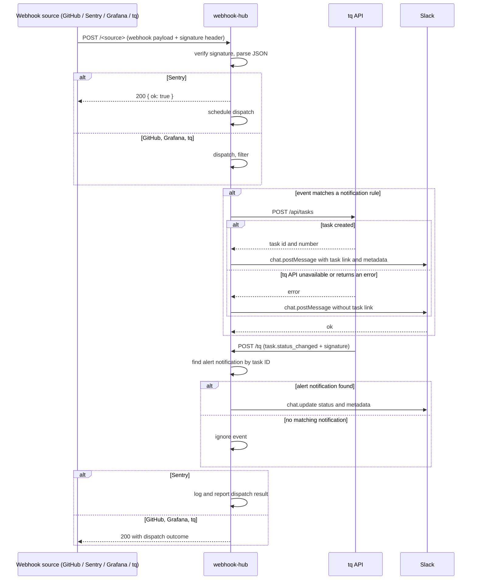

# Architecture

## Overview

webhook-hub is a single Hono HTTP service that receives webhooks from multiple sources (GitHub, Sentry, Grafana, tq), applies a small set of filters, and posts matching events to Slack.



## Request flow

Each registered `WebhookSource` (`src/webhook-source.ts`) is mounted at its own path and runs the same pipeline (`src/server.ts`):

1. `extractContext()` pulls source-specific delivery context from the request. Missing required headers return `400`; Grafana and tq generate random request IDs instead of reading a delivery ID header.
2. `verify()` checks the request's signature against the source's shared secret. Failure returns `401`.
3. The raw body is parsed as JSON. Parse failure returns `400`.
4. Sentry returns `200` with `{ ok: true }` and schedules `dispatch()` to run after the response. Other sources run `dispatch()` before responding.
5. If dispatch returns a notification, the Slack client posts it; otherwise processing is recorded as `filtered` or `ignored`.
6. GitHub, Grafana, and tq return `200` with `{ ok: true, outcome }` on success or `{ ok: false, outcome: "error" }` when dispatch fails. Sentry's dispatch result is logged and reported to Sentry after its response. A shutdown waits up to five seconds for scheduled dispatches to finish and reports any remaining deliveries.

### GitHub (`POST /github`)

Headers: `x-github-delivery`, `x-github-event`, `x-hub-signature-256`. `@octokit/webhooks` verifies the HMAC-SHA256 signature against `GITHUB_WEBHOOK_SECRET`.

### Sentry (`POST /sentry`)

Headers: `Request-ID`, `Sentry-Hook-Resource`, `Sentry-Hook-Signature`. The signature is an HMAC-SHA256 of the raw body against `SENTRY_WEBHOOK_SECRET`, compared with `timingSafeEqual` (`src/sources/sentry/verify.ts`).

### Grafana (`POST /grafana`)

Header: `X-Grafana-Alerting-Signature`. The signature is an HMAC-SHA256 of the raw body against `GRAFANA_WEBHOOK_SECRET`, compared with `timingSafeEqual` (`src/sources/grafana/verify.ts`); the optional timestamp header is not configured. Each firing or resolved alert with a non-empty fingerprint and valid `startsAt` is dispatched separately. Slack metadata stores the fingerprint, `startsAt`, and tq task reference. Redeliveries for the same incident update its message and reuse its task; a later incident with the same fingerprint creates a new message and task. History lookup is bounded to five pages within one day of the incident start.

The Slack notification includes alert labels, summary and description annotations, and available panel, dashboard, rule, and runbook links. It uses mrkdwn links for destinations because Slack interactive buttons require a separate request endpoint.

### tq (`POST /tq`)

Header: `X-Tq-Signature-256` in `sha256=<hex>` form. The signature is an HMAC-SHA256 of the raw body against `TQ_WEBHOOK_SECRET`, compared with `timingSafeEqual` (`src/sources/tq-status/verify.ts`). `task.status_changed` updates the matching CI, Sentry, or Grafana notification by its tq task ID. The lookup searches the most recent 1,000 Slack channel messages; events without a matching alert notification in that history are ignored.

## Notification rules

### `workflow_run`

A Slack message is posted only when **all** of the following are true:

- `action === "completed"`
- `workflow_run.conclusion === "failure"`
- `workflow_run.head_branch === repository.default_branch`
- `workflow_run.head_repository.full_name === repository.full_name` — excludes runs originating from forks, whose `head_branch` can collide with the upstream default branch name.

The message is posted as a Slack attachment with a red border, containing Block Kit blocks:

1. **header** — `🚨 {workflow name} failed`
2. **section** — four fields:

   | Field      | Content                                                                                                                                |
   | ---------- | -------------------------------------------------------------------------------------------------------------------------------------- |
   | Repository | `{repo}`                                                                                                                               |
   | 起点の PR  | `#{PR number} {PR title}` linked to the merged PR, or the commit message's first line when no PR is found for `push`; `なし` otherwise |
   | 失敗箇所   | `` `{job name}` › `{step name}` `` for the first failed job/step, or `不明` when unavailable                                           |
   | トリガー   | `push`, `定期実行` for `schedule`, `` `@{actor}` が手動実行 `` for `workflow_dispatch`, or `` `{event}` 起因 `` for other triggers     |

3. **context** — `<run url|View run>`

The message is posted with a custom bot identity (username `GitHub CI`, GitHub Actions' avatar), requiring the `chat:write.customize` Slack scope.

The PR and failed-step lookups use the GitHub REST API via octo-sts. A failed PR lookup on `push` falls back to the commit message's first line, and an unavailable failed step displays `不明`; the notification still posts in either case.

### `pull_request`

Handled for `action === "opened"` and `action === "closed"`, when at least one of:

- the PR title ends with `[security]` (matched by `/\[security\]\s*$/`), or
- the head branch matches `/^renovate\/.*-vulnerability$/`.

The message tags the PR as a security PR, includes the title, and links to the PR page. A coloured attachment border encodes the lifecycle state:

| State                    | Border colour | Slack action                                   |
| ------------------------ | ------------- | ---------------------------------------------- |
| opened                   | green         | `chat.postMessage`                             |
| merged (closed + merged) | purple        | `chat.update` on the original `opened` message |
| closed without merging   | red           | `chat.update` on the original `opened` message |

The link back to the original message uses Slack message metadata (`event_type: "security_pr"`, `event_payload: { pr_url }`). On a `closed` event the handler scans recent `conversations.history` of `SLACK_CHANNEL` for a matching metadata payload and edits that message in place. If no matching message is found (e.g. the original is past the history window, or the bot was offline when the PR was opened), the close notification is posted as a new message instead.

For `action === "opened"` PRs that aren't security PRs, a third-party check runs instead (see below). All other events and actions short-circuit to `ignored`.

### Third-party `issues` / `pull_request`

A Slack message is posted to `SLACK_ACTIVITY_CHANNEL` (default `#github_activity`) when `action === "opened"` and the sender is neither a bot nor the repository owner:

- `sender.type !== "Bot"` — excludes GitHub Apps such as Renovate and Dependabot without needing a bot-name allowlist.
- `sender.login !== repository.owner.login` — excludes issues/PRs opened by the repository owner themselves.

The message links to the issue/PR and names its author; it carries no color or metadata, since there's no follow-up state to track. `pull_request` evaluates the security-PR check first — a third-party security PR is reported through that flow, not this one.

```
:speech_balloon: *New pull request opened on `fohte/example` by `octocat`*
*fix: support <T> generics*
<https://github.com/fohte/example/pull/2|View pull request>
```

(`issues` uses the same format with "issue" in place of "pull request".)

All other events and actions short-circuit to `ignored` or `filtered`.

### `star`

Handled for `action === "created"` only; `action === "deleted"` (unstar) short-circuits to `ignored`. GitHub's webhook subscription is per-event rather than per-action, so `deleted` payloads still arrive and must be filtered in the handler.

The message is posted to `SLACK_ACTIVITY_CHANNEL` (default `#github_activity`) rather than `SLACK_CHANNEL`, since a star is not an alert.

### Sentry issue alerts

A Slack message is posted only when **both** of the following are true:

- `Sentry-Hook-Resource === "event_alert"`
- `payload.action === "triggered"`

The red attachment uses the issue title in a header, the project slug, level, culprit, and triggered rule in section fields, and a link to the issue page in a context block. Empty project slug and culprit values are omitted.

The alert's Sentry issue ID is stored in Slack message metadata. For `Sentry-Hook-Resource === "issue"`, `action === "resolved"` folds every matching source attachment among up to the 1,000 most recent channel messages, while `action === "unresolved"` restores it. Messages without readable content are skipped.

Every matching CI, Sentry, or Grafana alert attempts to create a personal-context tq task with the alert details and source URL in its description. The Slack notification keeps the source alert in one attachment and, on successful task creation, adds a separate attachment with the `todo` status and a link to the task. Slack message metadata contains the task ID. Task creation failures are logged and captured, while the source alert still posts without a tq attachment. Grafana processes every alert in a grouped payload even if one alert's Slack delivery fails.

All other resources and actions short-circuit to `ignored`. No further filtering is applied on top of this — every verified, triggered issue alert is forwarded.
